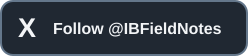

# IB Notes

**Observe. Record. Learn.**

**[Getting started](docs/QUICK_START.md) · [Import your own CSV](docs/CSV_IMPORT.md) · [Create and track levels](docs/LEVELS.md)**

IB Notes is a free journal for studying the Initial Balance: the first hour of
the regular trading session. Record prices, build a map of the session, track
breaks and returns, and review what happened.

Built around an ES study workflow, with configurable instruments, session times
and display timezones. It runs in your browser and can be added to your phone's
Home Screen from a hosted HTTPS address.

## Private review

This is the IB Notes organization’s private review copy. There is no public
installation address yet. The prepared package is available under [downloads](downloads/).
The public address and phone-install instructions will be confirmed before
inviting testers.

## What you can do

- Record High, CP (current price) and Low observations with editable times.
- Follow overnight, 15-minute, A, B and post-IB periods.
- See recorded prices against the session's ranges and nearby levels.
- Track IB edge breaks, returns, notes and significant-level history.
- Review days and local statistics, and create shareable recaps and images.
- Export and restore SQLite backups of your journal.

The journal starts empty. You supply your own observations using data you have
permission to use. There is no included market history, live price feed or
automatic news lookup. Historical forecast probabilities require compatible
learning history and are unavailable in the empty edition.

## Start here

1. Read [installation and preview instructions](docs/INSTALLATION.md).
2. Follow the [first-session guide](docs/QUICK_START.md).
3. See the [screenshots](docs/SCREENSHOTS.md) and [review checklist](docs/REVIEW.md).
4. Follow the [CSV import guide](docs/CSV_IMPORT.md) to prepare and use your own permitted history.
5. Learn to [create levels and read their tracking history](docs/LEVELS.md).

Your journal is stored locally in your browser on that device. Export a SQLite
backup before changing app addresses, clearing browser data or moving devices.
There is no automatic journal synchronization.

## Support and updates

Problems or feedback: **ibnotes.support@icloud.com**. Settings also includes
**Report a problem**, where you can review and copy a report.

The app is free to use. Optional support: [IB Notes on Ko-fi](https://ko-fi.com/ibnotes).

Updates and announcements: [@IBFieldNotes on X](https://x.com/IBFieldNotes).

Structure journal only. No trade recommendations.

## Source and package

- [Download the prepared website package](downloads/IB-Notes-blank-slate.zip).
- [Build identity and checks](release-info.json).
- `site/` contains the reviewed static PWA files.
- `apps/`, `packages/` and `scripts/` contain the data-free application source.

Source code: [MPL 2.0](LICENSE). Dependencies retain their own licenses; see
[third-party notices](site/THIRD-PARTY-NOTICES.txt). Branding and artwork are
outside the source-code license grant.
