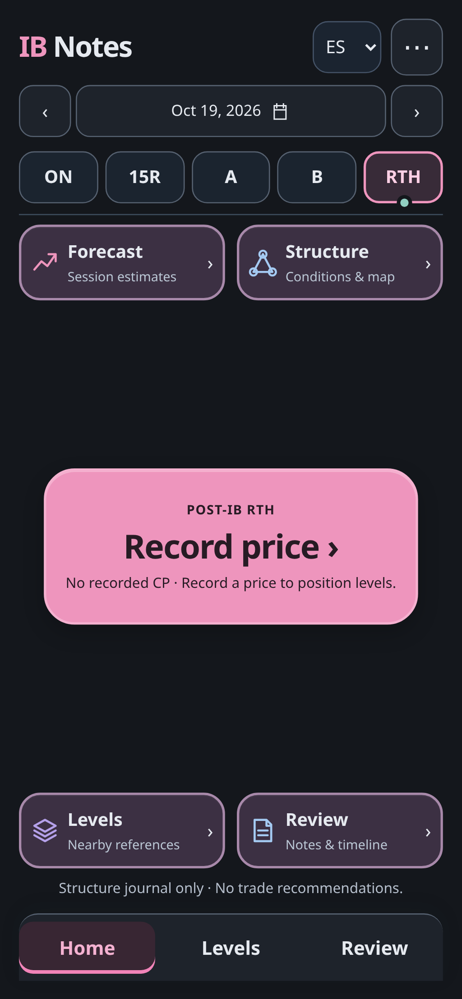
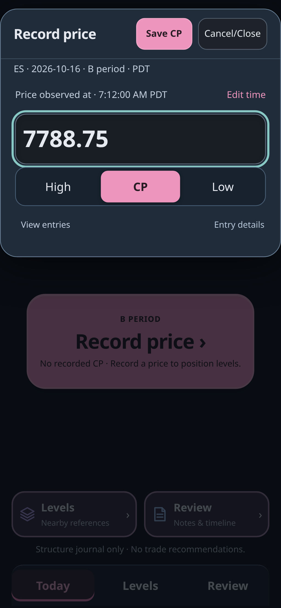
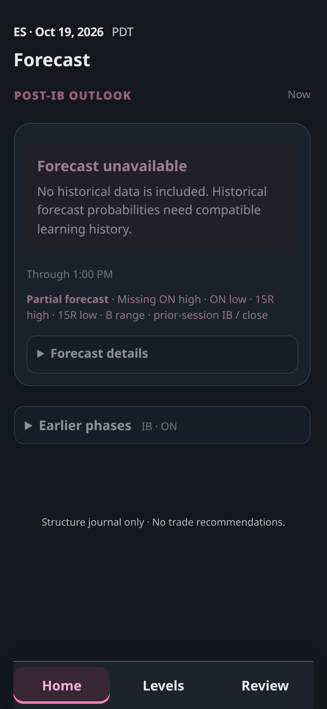
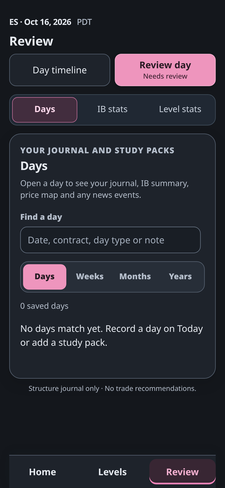
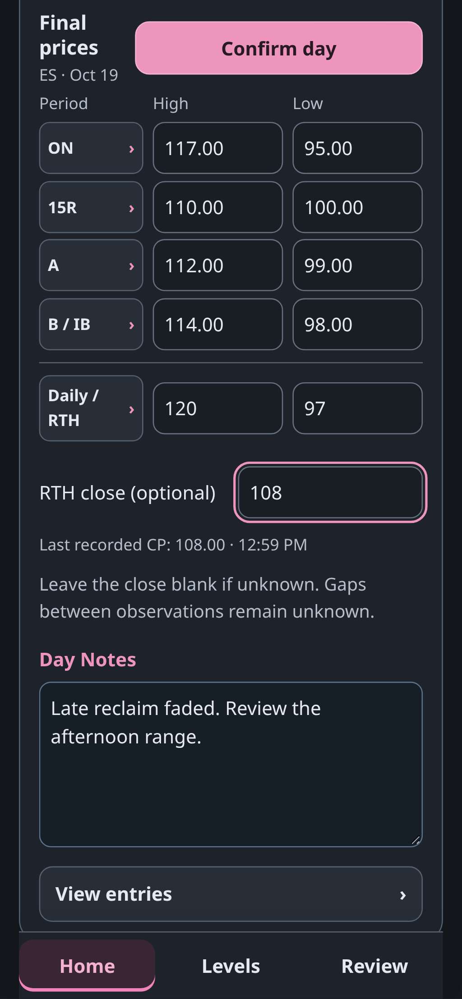
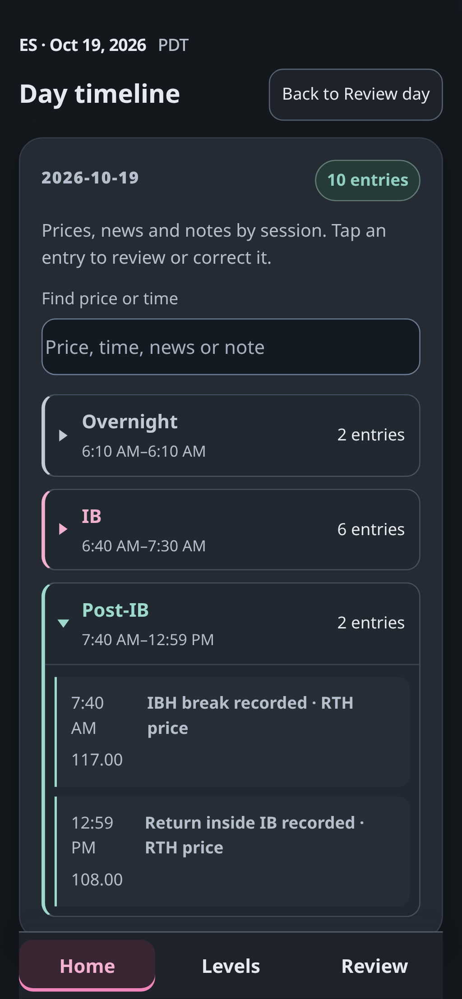

# Interface screenshots

These captures come from isolated browser checks of the prepared edition.
Prices in the entry-sheet image are illustrative development inputs, not
historical market records. No example sessions are installed with the app.

## Empty dashboard

## Price entry

## Forecast without learning history

## Review navigation

## Review day and Day Notes

## Day timeline

